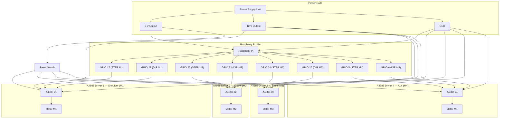
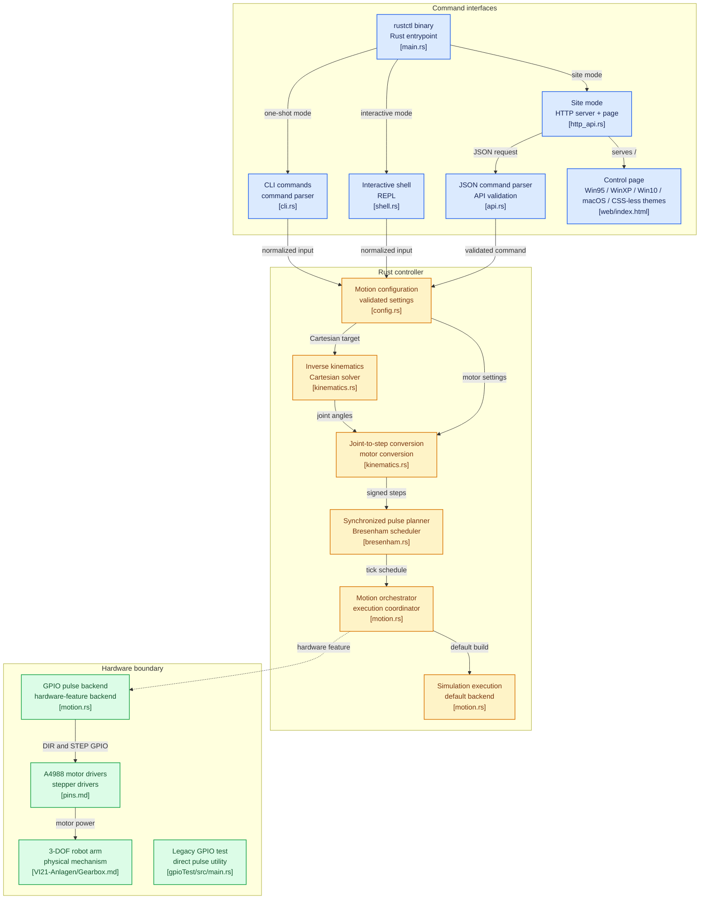
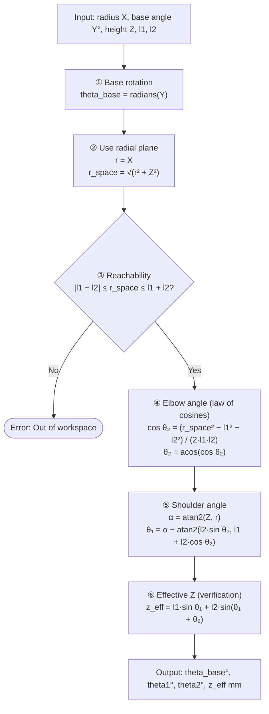
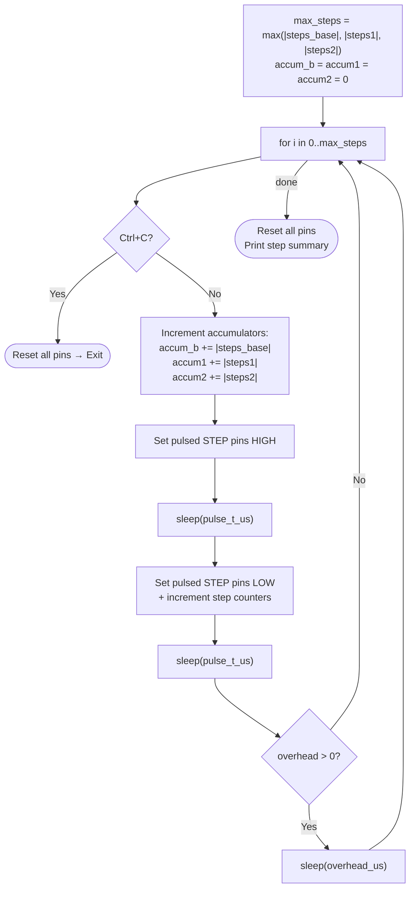

# Roboterarm HASE


> **Open-source robot arm and control software** developed by students of the  
> [Humboldt Academy for Science and Engineering](https://www.hgv.de) at HGV Vaterstetten.

---

## Table of Contents

1. [Team](#1-team)
2. [Project Overview](#2-project-overview)
3. [Hardware](#3-hardware)
   - 3.1 [Bill of Materials](#31-bill-of-materials)
   - 3.2 [Pin Mapping](#32-pin-mapping)
   - 3.3 [Wiring Diagram](#33-wiring-diagram)
   - 3.4 [A4988 Motor Driver Setup](#34-a4988-motor-driver-setup)
   - 3.5 [Microstepping Reference](#35-microstepping-reference)
4. [Software Architecture](#4-software-architecture)
   - 4.1 [Repository Structure](#41-repository-structure)
   - 4.2 [Component Overview](#42-component-overview)
   - 4.3 [rustctl — Main Control Program](#43-rustctl--main-control-program)
   - 4.4 [gpioTest — Hardware Test Utility](#44-gpiotest--hardware-test-utility)
   - 4.5 [Web Control Page](#45-web-control-page)
   - 4.6 [Image and Build Tools](#46-image-and-build-tools)
5. [Inverse Kinematics](#5-inverse-kinematics)
   - 5.1 [Coordinate System](#51-coordinate-system)
   - 5.2 [Mathematical Model](#52-mathematical-model)
   - 5.3 [Step Conversion](#53-step-conversion)
6. [Motor Synchronization Algorithm](#6-motor-synchronization-algorithm)
7. [Installation & Usage](#7-installation--usage)
   - 7.1 [Prerequisites](#71-prerequisites)
   - 7.2 [Build & Run](#72-build--run)
   - 7.3 [CLI Modes](#73-cli-modes)
   - 7.4 [API Implementation Guide](#74-api-implementation-guide)
   - 7.5 [Testing on a PC](#75-testing-on-a-pc)
   - 7.6 [Running on a Raspberry Pi](#76-running-on-a-raspberry-pi)
   - 7.7 [Building a Raspberry Pi OS Image](#77-building-a-raspberry-pi-os-image)
8. [Known Issues & Limitations](#8-known-issues--limitations)
9. [Future Goals](#9-future-goals)
10. [References](#10-references)

---

## 1. Team

| Member | Role | Status |
|--------|------|--------|
| **Patrick** | Software development, cable management, PCB design | Retired |
| **Luca** | Organisation, Rust development, Web server, 3D design & printing, oscilloscope analysis | Active |
| **Johannes** | build suite, Docker Development, Linux setup & guide | Active |
| **Florian** | General support across tasks | Active |
| **Julian** | Soldering, calculations & design review | Active |

---

## 2. Project Overview

The **Roboterarm HASE** project builds a fully open-source robotic arm paired with control software running on a [Raspberry Pi 4B+](https://www.raspberrypi.com/products/raspberry-pi-4-model-b/). The arm has **three active degrees of freedom**:

| Axis | Motor | Joint | IK Variable |
|------|-------|-------|-------------|
| Base rotation | M3 | Rotates entire arm around vertical axis | `theta_base` |
| Shoulder | M1 | First rigid link | `theta1` |
| Elbow | M2 | Second rigid link | `theta2` |
| Auxiliary | M4 | Reserved — currently unused | — |

The control software computes **3D inverse kinematics** to translate a target XYZ coordinate in millimeters into motor step counts, then drives the three active [A4988](https://www.pololu.com/file/0J450/A4988.pdf) stepper motor channels through the Pi's GPIO pins. A fourth motor channel is reserved for future use.

The project is funded by sponsors and public grants as part of the school's STEM program.


---

## 3. Hardware

### 3.1 Bill of Materials

| Component | Qty | Purpose | Reference |
|-----------|-----|---------|-----------|
| Stepper Motor (NEMA 17-compatible) | 4 | Drives each axis | — |
| [Raspberry Pi 4B+](https://www.raspberrypi.com/products/raspberry-pi-4-model-b/) | 1 | Main compute unit; runs `rustctl` | — |
| [A4988 Stepper Driver](https://www.pololu.com/product/1182) | 4 | Translates STEP/DIR pulses to motor current | [Datasheet](https://www.pololu.com/file/0J450/A4988.pdf) |
| Power Supply Unit | 1 | Dual-rail: 5 V (logic) + 12 V (motors) | — |
| Arduino Mega | 1 | Oscilloscope signal analysis | — |
| [Rigol DS1052E Oscilloscope](https://www.rigol.eu/products/oscilloscopes/ds1000e/) | 1 | Signal quality verification | — |
| Aluminum extrusion profile | — | Structural frame | — |
| [Bambulab PETG-CF](https://bambulab.com/en/filament/high-speed) | — | Structural 3D-printed parts | — |
| [Bambulab PLA-Matte](https://bambulab.com/en/filament/pla) | — | Non-structural 3D-printed parts | — |
| Reset switch (momentary) | 1 | Shared RESET line across all 4 A4988 drivers | — |
| 100 µF electrolytic capacitor | 4 | VMOT spike suppression (one per A4988) | — |

### 3.2 Pin Mapping

Each A4988 driver needs a **STEP** and **DIR** GPIO signal from the Raspberry Pi.  
All BCM pin numbers reference the [pinout.xyz](https://pinout.xyz) standard.

| Motor | Joint | STEP pin (BCM) | DIR pin (BCM) | Active |
|-------|-------|:--------------:|:-------------:|:------:|
| M1 | Shoulder (Arm 1) | GPIO 17 | GPIO 27 | ✅ |
| M2 | Elbow (Arm 2) | GPIO 22 | GPIO 23 | ✅ |
| M3 | Base rotation | GPIO 24 | GPIO 25 | ✅ |
| M4 | Auxiliary | GPIO 5 | GPIO 6 | ⬜ unused |

### 3.3 Wiring Diagram



### 3.4 A4988 Motor Driver Setup

The [A4988](https://www.pololu.com/file/0J450/A4988.pdf) is a microstepping driver with a built-in translator. See the [Last Minute Engineers tutorial](https://lastminuteengineers.com/a4988-stepper-motor-driver-arduino-tutorial/) for a full wiring guide.

| Pin | Function | Notes |
|-----|----------|-------|
| **STEP** | Advance one microstep per rising edge | Minimum pulse width: 1 µs |
| **DIR** | Rotation direction | HIGH or LOW |
| **RESET** | Active-low reset | Tie to SLEEP, or connect to shared reset switch |
| **SLEEP** | Low-power mode | Tie HIGH to keep driver active |
| **VMOT** | Motor power (8–35 V) | 12 V in this project |
| **VDD** | Logic power (3–5.5 V) | From Raspberry Pi 3.3 V or 5 V |
| **MS1/MS2/MS3** | Microstepping mode | See table below |
| **A1, A2, B1, B2** | Motor coil outputs | Connect to stepper motor windings |

> [!WARNING]
> Place a **100 µF electrolytic capacitor** close to each driver's VMOT and GND pins to suppress inductive voltage spikes. Without it, the A4988 may be destroyed when motors decelerate.

> [!IMPORTANT]
> Set the **current limit** via the onboard potentiometer before powering the motors. Exceeding the motor's rated current causes overheating. Formula: `V_ref = I_max × 8 × R_sense` (R_sense is typically 0.1 Ω on clone boards → `V_ref = 0.8 × I_max`).

### 3.5 Microstepping Reference

| MS1 | MS2 | MS3 | Resolution |
|:---:|:---:|:---:|:----------:|
| LOW | LOW | LOW | Full step |
| HIGH | LOW | LOW | 1/2 step |
| LOW | HIGH | LOW | 1/4 step |
| HIGH | HIGH | LOW | 1/8 step |
| HIGH | HIGH | HIGH | **1/16 step** ← project default |

---

## 4. Software Architecture

### 4.1 Repository Structure

```
Roboterarm-HASE/
├── rustctl/                     ← Main Rust controller
│   ├── src/                     ← CLI, shell, API, kinematics, motion, GPIO
│   ├── web/index.html           ← Embedded control page and its themes
│   ├── tests/site_e2e.rs        ← Tests that launch a real --site process
│   └── Cargo.toml / Cargo.lock
├── gpioTest/                    ← Early GPIO pulse test utility
├── image-builder/               ← Raspberry Pi OS image customization tool
│   ├── builder/cli.py           ← Image build CLI
│   ├── image.sh                 ← Interactive image build helper
│   ├── config.md                ← Full image-builder configuration reference
│   ├── basic-config.yaml        ← Safe starter configuration
│   ├── minimal-config.yaml      ← Package-pruning example
│   └── examples/                ← Netplan, systemd, file, and hook examples
├── docker/                      ← Older ARM64 binary build files
├── VI21-Anlagen/                ← Drawings, gearbox notes, measurements, media
│   └── encodethesecond.py       ← Interactive ffmpeg ProRes conversion helper
├── EndEffector.scad             ← OpenSCAD end-effector connector model
├── inverseKinematics.ods        ← IK calculation spreadsheet
├── pins.md                      ← Wiring and pin mapping notes
├── A4988.png / pinout.xyz.png   ← Hardware reference images
├── arduino-oscilloscope/        ← Git submodule
├── pi-gpio-emulator/            ← Git submodule
├── compile.cmd                  ← Legacy Go-to-ARM build script
├── LICENSE
└── CODE_OF_CONDUCT.md
```

The repository has no root Cargo workspace; run Rust commands from `rustctl/`
or `gpioTest/`. The `compile.cmd` helper is a legacy Go build script and the
repository contains no Go source for it.

### 4.2 Component Overview

```mermaid
flowchart LR
    Browser["Browser UI\n(control page)"]
    WebServer["rustctl --site\nHTTP server + page"]
    rustctl["rustctl\n(Rust — active)"]
    GPIO["Raspberry Pi GPIO"]
    A4988s["4× A4988 Drivers"]
    Motors["4× Stepper Motors"]
    Arm["Robot Arm"]

    Browser -->|"HTTP"| WebServer
    WebServer -->|"in-process"| rustctl
    rustctl -->|"rppal GPIO"| GPIO
    GPIO -->|"STEP + DIR pulses"| A4988s
    A4988s -->|"Motor current"| Motors
    Motors --> Arm
```



### 4.3 rustctl — Main Control Program

**Language:** Rust (edition 2024)

- **Core crates:** `serde`, `serde_json`, `if-addrs`
- **Optional Linux hardware crates:** [`rppal`](https://docs.rs/rppal/latest/rppal/) `0.22.1`, [`ctrlc`](https://docs.rs/ctrlc/latest/ctrlc/) `3.5.2`



**Motor mapping:**

| Variable | GPIO STEP | GPIO DIR | Joint | IK Angle |
|----------|:---------:|:--------:|-------|----------|
| `m1` | 17 | 27 | Shoulder | `theta1` |
| `m2` | 22 | 23 | Elbow | `theta2` |
| `m3` | 24 | 25 | Base rotation | `theta_base` |
| `m4` | 5 | 6 | Auxiliary | *(unused)* |

### 4.4 gpioTest — Hardware Test Utility

**Language:** Rust (edition 2024) | **Crates:** [`rppal`](https://docs.rs/rppal/latest/rppal/) `0.22.1`

An early-stage test used to verify that stepper motors respond to GPIO pulses before the IK logic was written. Key differences from `rustctl`:

| Feature | gpioTest | rustctl |
|---------|:--------:|:-------:|
| Inverse kinematics | ❌ | ✅ |
| DIR pin control | ❌ | ✅ |
| Multi-axis synchronization | ❌ | ✅ |
| Graceful shutdown (Ctrl+C) | ❌ | ✅ |
| Argument parsing | ❌ | ✅ |
| Infinite loop | ✅ | ❌ |

> [!WARNING]
> `gpioTest` has no graceful shutdown or explicit pin cleanup. It runs until the process is stopped; use it only with controlled hardware. Prefer `rustctl` for normal operation.

### 4.5 Web Control Page

`rustctl --site` serves a single self-contained HTML page at `/` together with
the JSON API. The page lives in `rustctl/web/index.html` and is embedded into
the binary at compile time, so the deployed binary has no runtime file
dependency.

| Property | Value |
|----------|-------|
| Location in repo | `rustctl/web/index.html` |
| Served at | `GET /` and `GET /index.html` |
| Content type | `text/html; charset=utf-8` |
| External requests | none (no CDN, fonts, or images) |
| Themes | Win95 (default), Windows XP, Windows 10, macOS, and CSS-less |
| 3D preview | Interactive WebGL model, rendered locally from the entered link lengths and joint pose |

The five themes use the same markup with different styling:

| Theme | Behavior |
|-------|----------|
| `win95` | Classic Windows 95 look: beveled panels, chunky buttons, monospace system font. Selected by default. |
| `winxp` | Windows XP look: blue title bar, Luna-inspired controls, and a desktop background. |
| `win10` | Windows 10 look: Fluent-style controls, light title bar, and blue desktop background. |
| `macos` | macOS look: light title bar, traffic-light close control, rounded panels, and a soft desktop background. |
| `plain` | No CSS rules apply at all. Raw HTML, no layout, no colors; the close control is labeled `Quit server`. |

The title bar has a close button that quits the server; hover it to see the
action before clicking. Choose a theme from the dropdown. The selection is
written to `localStorage` under the key `rustctl-theme` and restored on the next page
load, so the browser remembers it across reloads and restarts. Switching
themes changes a `data-theme` attribute on the document element; no
stylesheet is loaded or removed.

The page has two motion forms — a Cartesian form and a raw joint-angle form —
and both accept the optional start position described in
[7.3 CLI Modes](#73-cli-modes). Leaving the three start fields at `0` means the
arm is homed and the target is absolute; entering the current joint angles makes
the move relative to that pose.

The **3D arm preview** follows the selected form's target pose. Drag the model
to orbit it and scroll to zoom. During a move, the page animates the model from
the supplied start angles to the target and shows estimated progress from the
planned step count and fixed step period. The API reports only when a move has
finished, so this percentage is a client-side estimate rather than live motor
feedback; simulation builds are labeled separately.

### 4.6 Image and Build Tools

[`image-builder/`](image-builder/) customizes a Raspberry Pi OS `.img` or
`.img.xz` inside a privileged Linux Docker container. It applies package,
network, systemd, and file configuration and writes an uncompressed image.
The build instructions are in [Section 7.7](#77-building-a-raspberry-pi-os-image).
The starter configs are
[`basic-config.yaml`](image-builder/basic-config.yaml) and
[`minimal-config.yaml`](image-builder/minimal-config.yaml); package pruning is
disabled in the basic config and enabled in the minimal one. The builder can
install a bundled `rustctl` binary for arm64 with the `hardware` feature.
Because image mounting requires loop devices and mount privileges, the compose
service runs as privileged. The full YAML reference is
[`image-builder/config.md`](image-builder/config.md).

[`VI21-Anlagen/encodethesecond.py`](VI21-Anlagen/encodethesecond.py) is a
standalone interactive FFmpeg helper that converts selected video files to
ProRes MOV files in an `encoded/` directory. It requires `ffmpeg` on the host.

The example systemd unit at
[`image-builder/examples/systemd/rustctl.service`](image-builder/examples/systemd/rustctl.service)
starts `rustctl --site` as the default control service.

[`docker/`](docker/) contains an older ARM64 build path. Its Dockerfile does
not enable the `hardware` Cargo feature, so it does not produce the GPIO-enabled
controller binary. Prefer `image-builder/` for the documented Pi image flow.
The root `compile.cmd` is a legacy Go-to-ARM script; this repository contains
no Go source for it.

---

## 5. Inverse Kinematics

> See also: [Wikipedia — Inverse Kinematics](https://en.wikipedia.org/wiki/Inverse_kinematics), [inverseKinematics.ods](inverseKinematics.ods)

### 5.1 Coordinate System

The arm is modeled as a **2-link planar manipulator** rotating around the vertical (Z) axis. Commands use cylindrical coordinates:

| Axis | Direction | Meaning |
|------|-----------|---------|
| X | Radius | Horizontal distance from the base axis, in millimeters |
| Y | Base angle | Rotation around the vertical axis, in degrees |
| Z | Height | Vertical distance, in millimeters |
| Origin | — | Center of arm base |

The base rotation motor (M3) swings the entire shoulder–elbow plane around Z. The shoulder (M1) and elbow (M2) then move within that plane.

### 5.2 Mathematical Model

**Function:** `ik_angles_3d_deg(x, y, z, l1, l2) → (theta_base, theta1, theta2, z_eff)`



All angles are returned in **degrees**. The `clamp(-1.0, 1.0)` before `acos` prevents NaN from floating-point rounding errors near the workspace boundary.

### 5.3 Step Conversion

**Function:** `deg_to_steps(angle_deg, steps_per_rev, microstep) → i64`

$$\text{steps} = \text{angle} \times \frac{\text{steps\_per\_rev} \times \text{microstep}}{360°} \times \text{GEAR\_RATIO}$$

| Constant | Value | Notes |
|----------|:-----:|-------|
| `GEAR_RATIO` | 16.0 | Hardcoded 16:1 reduction gearbox |
| `steps_per_rev` | 200 | Typical for 1.8°/step NEMA 17 |
| `microstep` | 16 | 1/16 microstepping (MS1+MS2+MS3 all HIGH) |

> [!NOTE]
> With the above defaults: **1° of joint angle = 142.2 motor steps**.  
> The **sign** of the result selects the direction; `set_direction()` maps positive/negative to HIGH/LOW on the DIR pin based on the `ccw_positive` flag.

> [!IMPORTANT]
> `deg_to_steps()` is always called with a **delta**, never an absolute angle.
> When a start position is supplied, the controller first computes
> `delta = target − start` per joint and converts that. A start of `0/0/0`
> means the axes are homed, so the delta equals the target and the behavior is
> identical to omitting the start position. Declaring a start position does
> **not** home the arm or confirm that it is actually there — it only tells the
> controller which pose to measure the move from.

---

## 6. Motor Synchronization Algorithm

The movement loop uses a **[Bresenham-like](https://en.wikipedia.org/wiki/Bresenham%27s_line_algorithm) integer accumulator** to distribute steps across three axes so they all start and finish simultaneously — achieving synchronized, coordinated motion.



**Timing constraints:**

| Parameter | Description | Constraint |
|-----------|-------------|------------|
| `total_time` | Target period per tick (µs) | ≥ `2 × pulse_t_us + 83` |
| `pulse_t_us` | STEP pulse HIGH/LOW width (µs) | ≥ 1 µs ([A4988 minimum](https://www.pololu.com/file/0J450/A4988.pdf)) |
| `overhead` | Remaining idle time per tick | `total_time − 2×pulse_t_us − 83` |

The 83 µs constant (`HARDWARE_OVERHEAD_US`) accounts for measured loop and GPIO
execution overhead.

---

## 7. Installation & Usage

### 7.1 Prerequisites

| Requirement | How to get it |
|-------------|---------------|
| Raspberry Pi 4B+ running Raspberry Pi OS | [raspberrypi.com/software](https://www.raspberrypi.com/software/) |
| Rust toolchain (stable) | `curl --proto '=https' --tlsv1.2 -sSf https://sh.rustup.rs \| sh` → [rustup.rs](https://rustup.rs) |
| GPIO access | Run with `sudo`, or add user to `gpio` group: `sudo usermod -aG gpio $USER` |
| Hardware wired correctly | See [Section 3](#3-hardware) |

> [!TIP]
> To avoid running with `sudo`, create a udev rule:  
> `echo 'SUBSYSTEM=="gpio", GROUP="gpio", MODE="0660"' | sudo tee /etc/udev/rules.d/99-gpio.rules`  
> Then log out and back in.

### 7.2 Build & Run

```bash
git clone https://github.com/HASE-HGV/Roboterarm-HASE.git
cd Roboterarm-HASE/rustctl
cargo build --release --features hardware
sudo ./target/release/rustctl --site
```

Cross-compiling from a non-Pi machine (e.g. a laptop):

```bash
# Install the ARM64 target
rustup target add aarch64-unknown-linux-gnu

# Build (requires a matching AArch64 Linux linker, here aarch64-linux-gnu-gcc)
CARGO_TARGET_AARCH64_UNKNOWN_LINUX_GNU_LINKER=aarch64-linux-gnu-gcc \
  cargo build --release --features hardware --target aarch64-unknown-linux-gnu

# Copy to Pi and run the web server
scp target/aarch64-unknown-linux-gnu/release/rustctl pi@<IP>:~/
ssh pi@<IP> "sudo ./rustctl --site"
```

Cross-compilation also requires an AArch64 Linux linker/toolchain configured
for the Rust target. Building natively on the Pi or using the
[image builder](#77-building-a-raspberry-pi-os-image) avoids that host setup.

### 7.3 CLI Modes

Timing is fixed in the controller: each step period is **1083 µs** and each STEP
pulse is **500 µs**. The timing values are no longer command-line arguments.

```text
rustctl --cli | --shell | --raw | --site | --help
```

| Mode | Description |
|------|-------------|
| `--cli` | Prompt for one XYZ position and execute it. |
| `--shell` | Repeatedly read position commands until EOF or Ctrl+C. |
| `--raw` | Repeatedly read raw joint angles until EOF or Ctrl+C. |
| `--site` | Serve the web control page and JSON API (default `0.0.0.0:8080`). |
| `--help` | Print the complete usage guide. |

> [!NOTE]
> `--api` was renamed to `--site`. The old flag is rejected with a message
> pointing at the new name, and the same process now serves the browser UI in
> addition to the JSON endpoints.

Position command format:

```text
radius_mm base_angle_deg height_mm l1_mm l2_mm steps_per_rev microstep ccw_positive [start_base_deg start_axis1_deg start_axis2_deg]
```

Here `X` is the radial distance from the base, `Y` is the base rotation in
degrees, and `Z` is the vertical height.

Raw angle command format:

```text
base_deg axis1_deg axis2_deg steps_per_rev microstep ccw_positive [start_base_deg start_axis1_deg start_axis2_deg]
```

#### Start position

Both command formats accept an optional trailing start position. It describes
the joint angles the arm is **currently at**, and the controller turns the
command into a relative move:

| Field | Order | Meaning |
|-------|:-----:|---------|
| `start_base_deg` | 1 | Current base rotation, in degrees. |
| `start_axis1_deg` | 2 | Current shoulder angle, in degrees. |
| `start_axis2_deg` | 3 | Current elbow angle, in degrees. |

```text
# Absolute move (arm is homed at 0/0/0) — 8 fields, no start position
100 0 50 200 200 200 16 1

# Relative move from 5/10/15 degrees — 11 fields
100 0 50 200 200 200 16 1 5 10 15
```

Rules:

- All three start angles are supplied together or not at all. Supplying one or
  two is a parse error, in text input and in JSON.
- `0 0 0` means the arm is homed at the origin, so the move is absolute. This
  keeps the original 8-field and 6-field commands working unchanged.
- The start position is a **declaration, not a measurement**. Nothing verifies
  the arm is actually at that pose. See
  [Known Issues](#8-known-issues--limitations).
- The controller does not remember the last commanded pose between requests.
  Every motion command carries its own start position; there is no chaining
  between moves.

`--cli` prompts for the three start angles after the target values. Pressing
Enter leaves each one at `0`.

### 7.4 API Implementation Guide

`--site` runs a small HTTP server for the bundled page and JSON clients. The
page at `/` is HTML; API routes return JSON. The page is embedded in the
executable, so no separate web server or static files are needed.

#### Start the server

On a development machine, use the default simulation build:

```bash
cd rustctl
cargo run -- --site
```

The startup banner shows the listening URL and whether GPIO is enabled. On a
Raspberry Pi, build with hardware support and start site mode explicitly:

```bash
cargo build --release --features hardware
sudo ./target/release/rustctl --site
```

The server listens on `0.0.0.0:8080` by default. Set
`RUSTCTL_SITE_ADDR=127.0.0.1:8080` to restrict it to local access, or choose a
specific interface and port. `RUSTCTL_API_ADDR` is a deprecated fallback.

#### Routes and request format

The server accepts one HTTP/1.0 or HTTP/1.1 request per connection and closes
the connection after replying. Requests with a body need a `Content-Length`;
chunked transfer encoding is not supported. Responses include a content length
and `Cache-Control: no-store`.

| Method | Path | Body | Purpose |
|--------|------|------|---------|
| `GET` | `/` or `/index.html` | empty | Serve the control page as HTML. |
| `GET` | `/status` | empty | Report hardware capability, busy state, and commands. |
| `GET` | `/help` | empty | Return command format help. |
| `GET` | `/test` | empty | Run five runtime self-checks. |
| `POST` | `/args` | JSON object | Convert a Cartesian target with inverse kinematics and execute it. |
| `POST` | `/raw` | JSON object | Execute supplied joint angles without inverse kinematics. |
| `POST` | `/api` | JSON object | Select an API operation with a `command` field. |
| `POST` | `/quit` | empty | Stop the server after active requests finish. |

A query string is ignored for routing, so `/status?format=json` is equivalent
to `/status`. Motion requests use JSON objects with named fields. The
`ccw_positive` field is a JSON boolean.

#### Cartesian motion: `POST /args`

Required fields are `radius_mm`, `base_angle_deg`, `height_mm`, `l1_mm`,
`l2_mm`, `steps_per_rev`, `microstep`, and `ccw_positive`. Link lengths must
be positive and numeric inputs must be finite. The target radius cannot be
negative. The modeled reach condition is
`abs(l1_mm - l2_mm) <= sqrt(radius_mm^2 + height_mm^2) <= l1_mm + l2_mm`.

| Field | Type | Meaning |
|-------|------|---------|
| `radius_mm` | number | Non-negative radial distance from the base axis. |
| `base_angle_deg` | number | Base rotation about the vertical axis, in degrees. |
| `height_mm` | number | Target height, in millimeters. |
| `l1_mm`, `l2_mm` | positive numbers | Lengths of the two arm links, in millimeters. |
| `steps_per_rev` | integer | Full motor steps per revolution (commonly `200`). |
| `microstep` | integer | Driver microstep subdivision (commonly `1`, `2`, `4`, `8`, or `16`). |
| `ccw_positive` | boolean | `true` maps positive calculated steps to counterclockwise rotation. |

```bash
curl -X POST http://127.0.0.1:8080/args \
  -H 'Content-Type: application/json' \
  --data '{"radius_mm":100,"base_angle_deg":0,"height_mm":50,"l1_mm":200,"l2_mm":200,"steps_per_rev":200,"microstep":16,"ccw_positive":true}'
```

Both motion routes also accept the optional `start_base_deg`,
`start_axis1_deg`, and `start_axis2_deg` fields. Supply all three or omit all
three. When supplied, the target is converted to travel relative to the
provided current pose; the controller does not measure or remember that pose.
A partial start position returns an error stating that all three fields are
required: `start position needs all of start_base_deg, start_axis1_deg and
start_axis2_deg`.

#### Raw motion: `POST /raw`

The raw route requires `base_deg`, `axis1_deg`, `axis2_deg`, `steps_per_rev`,
`microstep`, and `ccw_positive`. It bypasses inverse kinematics and does not
apply joint angle limits.

```bash
curl -X POST http://127.0.0.1:8080/raw \
  -H 'Content-Type: application/json' \
  --data '{"base_deg":0,"axis1_deg":25,"axis2_deg":30,"steps_per_rev":200,"microstep":16,"ccw_positive":true}'
```

#### Status, tests, and generic commands

Example responses (hardware capability depends on how the binary was built):

```json
{"ok":true,"status":"ready","hardware_enabled":false,"busy":false,"commands":["args","raw","status","help","test","quit"]}
{"ok":true,"status":"tests_completed","tests":{"passed":5,"failed":0,"checks":["runtime_test_ik_roundtrip","runtime_test_step_conversion","runtime_test_timing_validation","runtime_test_multi_axis_planner","runtime_test_start_position_is_relative"],"failures":[]}}
```

`POST /api` accepts the same fields with a `command` selector. Command names
are case-insensitive; `position` aliases `args`, and `tests` aliases `test`.
For example:

```bash
curl -X POST http://127.0.0.1:8080/api \
  -H 'Content-Type: application/json' --data '{"command":"status"}'
curl -X POST http://127.0.0.1:8080/api \
  -H 'Content-Type: application/json' --data '{"command":"args","radius_mm":100,"base_angle_deg":0,"height_mm":50,"l1_mm":200,"l2_mm":200,"steps_per_rev":200,"microstep":16,"ccw_positive":true}'
```

`{"command":"quit"}` sent to `/api` returns a JSON `bye` response but does
not stop the HTTP server. To shut down site mode, send an empty `POST /quit`;
the control page's title-bar close button uses this route.

#### Responses and client examples

Successful motion returns JSON such as
`{"ok":true,"status":"done","mode":"args","hardware_enabled":true}`.
A validly formatted request that cannot execute a move may still return HTTP
`200` with `"ok":false`; clients must inspect both the HTTP status and JSON
`ok` field. A non-hardware build calculates the move but sends no GPIO pulses.

| HTTP status | Meaning |
|-------------|---------|
| `200 OK` | Request handled; inspect `ok` for semantic or motion errors. |
| `400 Bad Request` | Invalid HTTP request or JSON, missing fields, or invalid `/quit` body. |
| `403 Forbidden` | A POST included an `Origin` that does not match its `Host`. |
| `404 Not Found` | Unknown GET route. |
| `405 Method Not Allowed` | Unsupported method for the route. |
| `408 Request Timeout` | Request data was not received before the read timeout. |
| `409 Conflict` | Another motion is in progress; the response reports `busy: true`. |

Python example:

```python
import json
from urllib.request import Request, urlopen
from urllib.error import HTTPError

body = {
    "radius_mm": 100, "base_angle_deg": 0, "height_mm": 50,
    "l1_mm": 200, "l2_mm": 200, "steps_per_rev": 200,
    "microstep": 16, "ccw_positive": True,
}
request = Request(
    "http://127.0.0.1:8080/args",
    data=json.dumps(body).encode("utf-8"),
    headers={"Content-Type": "application/json"},
    method="POST",
)
try:
    with urlopen(request, timeout=30) as response:
        result = json.load(response)
except HTTPError as error:
    result = json.load(error)
    raise RuntimeError(f"HTTP {error.code}: {result}") from error
if not result.get("ok"):
    raise RuntimeError(result.get("error", result))
print(result)
```

A browser page served by `rustctl` can use the same-origin API with `fetch`:

```javascript
async function moveArm(radius, baseAngle, height) {
  const response = await fetch("/args", {
    method: "POST",
    headers: { "Content-Type": "application/json" },
    body: JSON.stringify({
      radius_mm: radius,
      base_angle_deg: baseAngle,
      height_mm: height,
      l1_mm: 200,
      l2_mm: 200,
      steps_per_rev: 200,
      microstep: 16,
      ccw_positive: true,
    }),
  });
  const result = await response.json();
  if (!response.ok || !result.ok) {
    throw new Error(JSON.stringify(result));
  }
  return result;
}
```

#### Integration notes

- Each accepted connection gets its own worker. Requests can arrive while a
  move is running, but a second concurrent motion is rejected with HTTP `409`;
  queue motion commands in the client and wait for each response.
- A motion request is synchronous. Set a client timeout long enough for the
  expected move. A client-side timeout does not cancel a move already underway.
- POSTs with an `Origin` header are accepted only when its host matches the
  request's `Host`. The server does not emit CORS headers.
- The API has no authentication or TLS. Keep it on loopback or protect network
  access with a firewall and a trusted proxy.
- There is no sensor-based homing, position feedback, acceleration profile,
  joint angle limit, or collision detection. Validate application-specific
  limits before forwarding commands; restrict `/raw` to trusted operators.
- The default build simulates motion. Check `hardware_enabled` before assuming
  motors were energized.

### 7.5 Testing on a PC

The default build is simulation-only and does not access GPIO. Run Rust commands
from `rustctl/`:

```bash
cd rustctl
cargo test
cargo run -- --help
cargo run -- --cli
cargo run -- --shell
```

`cargo test` runs the unit tests and the loopback HTTP end-to-end tests in
[`tests/site_e2e.rs`](rustctl/tests/site_e2e.rs). They cover API parsing and
responses, HTTP routing and validation, CLI and shell behavior, kinematics,
timing, the multi-axis planner, simulation motion, and the `--site` process.
The hardware GPIO path still requires a Linux Raspberry Pi or suitable GPIO
test hardware.

To generate an optional LLVM coverage report, install the tooling and run it
from `rustctl/`:

```bash
rustup component add llvm-tools-preview
cargo install cargo-llvm-cov
cargo llvm-cov --summary-only
cargo llvm-cov --html --open
```

The latest default-build run on macOS reported **97.69% line coverage**,
**95.61% region coverage**, and **99.24% function coverage**. Line coverage is
100% in every Rust source module except `cli.rs` (90.54%), `shell.rs` (86.21%),
and `http_api.rs` (98.05%). The Linux-only GPIO implementation enabled by the
`hardware` feature is excluded on macOS, so it still needs coverage on a Linux
Raspberry Pi or other suitable GPIO test hardware.

### 7.6 Running on a Raspberry Pi

Build with hardware support on the Pi, then run the selected mode with GPIO access:

```bash
cd rustctl
cargo build --release --features hardware
sudo ./target/release/rustctl --shell
```

Commands are rejected with an error and the loop continues. Press **Ctrl+C** to
stop the current hardware operation safely.

### 7.7 Building a Raspberry Pi OS Image

The image builder prepares Raspberry Pi OS on macOS, Windows, or Linux through
Docker. It handles the Linux filesystem and loop-device operations inside its
container, so the host does not need an ext4 driver. The input `.img` remains
unchanged, and `.img.xz` files are decompressed automatically.

Place the Raspberry Pi OS image in `image-builder/input/`. The interactive
helper asks which image and config to use, where to write the result, and
whether to open the test shell:

```sh
./image-builder/image.sh
```

On Windows, run it from Git Bash or WSL with Docker Desktop installed. You can
also invoke the builder directly from the repository root (replace the input
filename as needed):

```sh
docker compose -f image-builder/compose.yaml run --rm --build builder \
  build \
  --input /input/image.xz \
  --config /project/basic-config.yaml \
  --output /output/raspios-custom.img
```

The output is written to `image-builder/output/raspios-custom.img`. The basic
configuration updates Raspberry Pi OS, installs `rustctl`, configures Netplan
with NetworkManager, and preserves the existing package set. The separate
[`minimal-config.yaml`](image-builder/minimal-config.yaml) enables APT pruning;
review its `packages.keep` list carefully before using it. Add `--test` to enter
the target image's chroot shell before finalizing; type `exit` to continue.

Press Enter at each prompt to use the defaults: the first available image
(currently `image-builder/input/image.xz`), `basic-config.yaml`,
`raspios-custom.img`, no test shell, and overwrite an existing output image.
Set `IMAGE_BUILDER_INPUT`,
`IMAGE_BUILDER_CONFIG`, `IMAGE_BUILDER_OUTPUT`, or `IMAGE_BUILDER_TEST` before
running the script to change those defaults. The normal build updates the base
system, installs `rustctl`, enables its `--site` systemd service, configures
Netplan, and prepares Guacamole and its boot service. The resulting `.img` is
ready to flash; flashing itself is the only manual step outside this workflow.

The builder installs missing packages listed under `packages.keep` and
`packages.extra`. With `packages.prune: true`, it marks these roots and the
selected Netplan backend as manual, then asks APT to purge unneeded automatic
packages. Essential packages remain protected. Keep any boot, firmware, or
hardware-support packages that are not dependencies of the declared roots.

The image sizing settings in `basic-config.yaml` cap the final image at 16 GB.
The builder temporarily expands the working image for package upgrades and
Guacamole, then shrinks the filesystem to its actual contents plus a 2 GB free
reserve. Raspberry Pi OS normally expands the root filesystem on first boot to
use the flashed card's capacity.

The builder runs privileged because it mounts the image's partitions through
loop devices. Docker Desktop handles those operations inside its Linux VM, so
Windows and macOS do not need an ext4 driver. On an x86 Linux host, ARM64
package scripts may require QEMU/binfmt support; an ARM64 host can run them
natively. Configuration paths are relative to the YAML file. Netplan files,
systemd units, and extra files are declared in that YAML. Bash hooks run on the
builder host outside the target chroot and receive `ROOTFS` (the mounted image
root) and `BUILD_STAGE` (`after_packages` or `before_finalize`).
The shared Netplan example configures Ethernet and the `Hothschpoth` WPA2
network; `basic-config.yaml` selects NetworkManager and installs that profile
with restrictive file permissions.

#### Guacamole at boot

With `guacamole.enabled: true`, the builder installs Docker and the SSH server,
preloads the official ARM64 `guacamole/guacamole` and `guacamole/guacd`
containers, and enables `guacamole.service`. On the Pi's first boot, the service
imports those local archives and starts both containers. It removes the archive
copies after a successful import to avoid storing duplicate image data. The Pi
does not need Internet access to download Guacamole when it boots.

The web interface uses port `2000`. By default it binds to the Pi's loopback
interface. To open it from a computer, create an SSH tunnel and then browse to
`http://127.0.0.1:2000/`:

```sh
ssh -L 2000:127.0.0.1:2000 <pi-user>@<pi-ip>
```

For direct LAN access, set `guacamole.target_bind_address` to `0.0.0.0` in the
YAML configuration and use a non-default Guacamole password. The starter config
uses `root`/`root`; change these values before exposing the service.

Guacamole forwards its web-login credentials to the SSH connection as
`${GUAC_USERNAME}` and `${GUAC_PASSWORD}`. This removes the second credential
prompt when the Raspberry Pi accepts the same username and password for SSH.
Guacamole does not create a Linux account or bypass the Pi's SSH authentication
policy, so configure the web-login credentials to match an existing SSH account.
See the [Apache Guacamole credential-token documentation](https://guacamole.apache.org/doc/gug/configuring-guacamole.html#parameter-tokens).

The builder's file-based login is intended for a small, trusted setup. The
default `root`/`root` values are examples; set them to credentials accepted by
the Pi's SSH account. Root SSH login is commonly disabled, so a normal Pi user
is usually the appropriate choice.

When enabled, the builder also creates an optional
`image-builder/output/raspios-custom-guacamole/` Compose bundle for local
testing on a Docker host. See [`image-builder/config.md`](image-builder/config.md)
for all builder settings, hooks, Netplan, systemd, and Guacamole options.

---

## 8. Known Issues & Limitations

| # | Issue | Severity | Details |
|---|-------|:--------:|---------|
| 1 | **No homing or position feedback** | 🔴 High | Start angles are declarations supplied by the caller. There are no sensors to confirm the pose or detect missed steps. |
| 2 | **No acceleration profile** | 🟠 Medium | Steps use a fixed period, so abrupt starts can cause missed steps. |
| 3 | **No mechanical joint limits or collision checks** | 🟠 Medium | IK rejects targets outside the two-link reach, but does not model joint stops, the physical arm envelope, or obstacles. |
| 4 | **M4 is unused** | 🟠 Medium | The auxiliary motor mapping has no motion command or IK axis. |
| 5 | **Gear ratio is fixed** | 🟡 Low | `GEAR_RATIO` is set to `16.0` in `rustctl/src/config.rs`. |
| 6 | **`gpioTest` is an unsafe early utility** | 🟠 Medium | It loops indefinitely without Ctrl+C handling and has no direction control. Prefer `rustctl` for hardware motion. |
| 7 | **Site API has no authentication or TLS** | 🔴 High | It binds to `0.0.0.0:8080` by default. Restrict the bind address or protect it with a firewall and trusted proxy. |

---

## 9. Future Goals

### Short-Term (Next Semester)

- **Homing sequence**  
  Add [limit switches](https://www.pololu.com/category/132/switches) or hall-effect sensors to all three active axes. On startup, each axis moves toward its zero position until it triggers its sensor, establishing an absolute reference frame.

- **Web UI polish**  
  Extend the bundled control page with persisted presets, last-position display, and visual feedback for successful/failed requests while keeping the plain CSS-less theme fully functional.

- **Motor M4 end-effector**  
  Assign M4 to a gripper or wrist-roll joint. Extend the IK model and add `grip_open` / `grip_close` commands to the CLI and webserver API.

- **Configurable gear ratio**  
  Replace the hardcoded `GEAR_RATIO = 16.0` with a CLI flag or a `config.toml` so the software is hardware-independent.

---

### Medium-Term

- **Acceleration / deceleration profiles**  
  Implement a trapezoidal or [S-curve ramp](https://www.linearmotiontips.com/how-to-calculate-velocity-s-curve-motion-profile/) in the step loop so motors accelerate smoothly at the start and decelerate before stopping. This eliminates the primary source of missed steps.

- **Closed-loop position feedback**  
  Add [magnetic rotary encoders](https://www.pololu.com/category/165/magnetic-encoders) (e.g. AS5600 via I²C) to each axis. Compare commanded vs. actual angle and implement a PID correction loop to compensate for missed steps.

- **Joint angle limits**  
  Enforce per-axis `[min_deg, max_deg]` bounds and add collision checks for the physical arm, beyond the current two-link reach calculation.

- **Cartesian path planning (linear interpolation)**  
  Split a move into `N` small IK waypoints spaced evenly in Cartesian space, ensuring the TCP travels in a straight line rather than an arc. Essential for precise assembly or drawing tasks.

- **GPIO simulator for development**  
  Integrate the existing `pi-gpio-emulator` submodule with a safe development backend for `rustctl`, so STEP/DIR behavior can be inspected without a Raspberry Pi.

---

### Long-Term

- **[ROS 2](https://docs.ros.org/en/jazzy/) integration**  
  Wrap `rustctl` as a [ROS 2](https://docs.ros.org/en/jazzy/) node and expose the arm as a [MoveIt 2](https://moveit.ros.org/)-compatible manipulator. Unlocks trajectory planning, obstacle avoidance, and integration with vision pipelines.

- **Computer vision pick-and-place**  
  Attach a [Raspberry Pi Camera Module 3](https://www.raspberrypi.com/products/camera-module-3/) and run an object detection model (e.g. [YOLOv8](https://docs.ultralytics.com/)) to autonomously locate and grasp objects placed in the arm's workspace.

- **Custom motor controller PCB**  
  Design a Raspberry Pi HAT that integrates all four A4988 drivers, decoupling capacitors, the reset circuit, and status LEDs in a single board — replacing the current breadboard setup with a compact, reliable solution.

- **Multi-arm coordination**  
  Extend the software to coordinate two or more arms over a local network for collaborative assembly tasks.

---

## 10. References

| Resource | Link |
|----------|------|
| A4988 Datasheet | [pololu.com](https://www.pololu.com/file/0J450/A4988.pdf) |
| A4988 Wiring Tutorial | [lastminuteengineers.com](https://lastminuteengineers.com/a4988-stepper-motor-driver-arduino-tutorial/) |
| A4988 Instructables Guide | [instructables.com](https://www.instructables.com/Stepper-Motor-Driverfor-A4988-and-Similar-Devices/) |
| Raspberry Pi GPIO Pinout | [pinout.xyz](https://pinout.xyz) |
| Raspberry Pi 4B+ Specs | [raspberrypi.com](https://www.raspberrypi.com/products/raspberry-pi-4-model-b/specifications/) |
| rppal crate docs | [docs.rs/rppal](https://docs.rs/rppal/latest/rppal/) |
| ctrlc crate docs | [docs.rs/ctrlc](https://docs.rs/ctrlc/latest/ctrlc/) |
| Rust installation | [rustup.rs](https://rustup.rs) |
| Bresenham's line algorithm | [Wikipedia](https://en.wikipedia.org/wiki/Bresenham%27s_line_algorithm) |
| Inverse kinematics | [Wikipedia](https://en.wikipedia.org/wiki/Inverse_kinematics) |
| ROS 2 documentation | [docs.ros.org](https://docs.ros.org/en/jazzy/) |
| MoveIt 2 | [moveit.ros.org](https://moveit.ros.org/) |
| Rigol DS1052E | [rigol.eu](https://www.rigol.eu/products/oscilloscopes/ds1000e/) |

---

*Project documentation · [HASE-HGV/Roboterarm-HASE](https://github.com/HASE-HGV/Roboterarm-HASE) · [Open an issue](https://github.com/HASE-HGV/Roboterarm-HASE/issues)*
